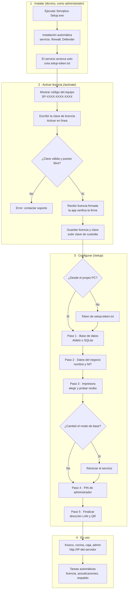

# Serviplus

Sistema POS, kiosco y KDS para restaurantes. Se instala en un PC Windows dedicado del restaurante y las demás pantallas se conectan a él desde la red local.

## Flujo de instalación y activación



**Leyenda:** los rectángulos son pasos y los rombos son decisiones. Las rutas entre paréntesis son las páginas del navegador.

### Notas

- Durante la configuración, el asistente solo acepta cambios desde el propio PC del servidor. Desde otro equipo de la red hace falta el token de `C:\ProgramData\ServiPlus\setup-token.txt`.
- Si el modo de base de datos cambia en el paso 1, el servicio debe reiniciarse antes del PIN de administrador:
  ```powershell
  cd "C:\Program Files\Serviplus"
  .\serviplus-service.exe restart
  ```
- Desde los demás dispositivos se usa la IP del servidor. El nombre `serviplus.local` todavía no está disponible.
